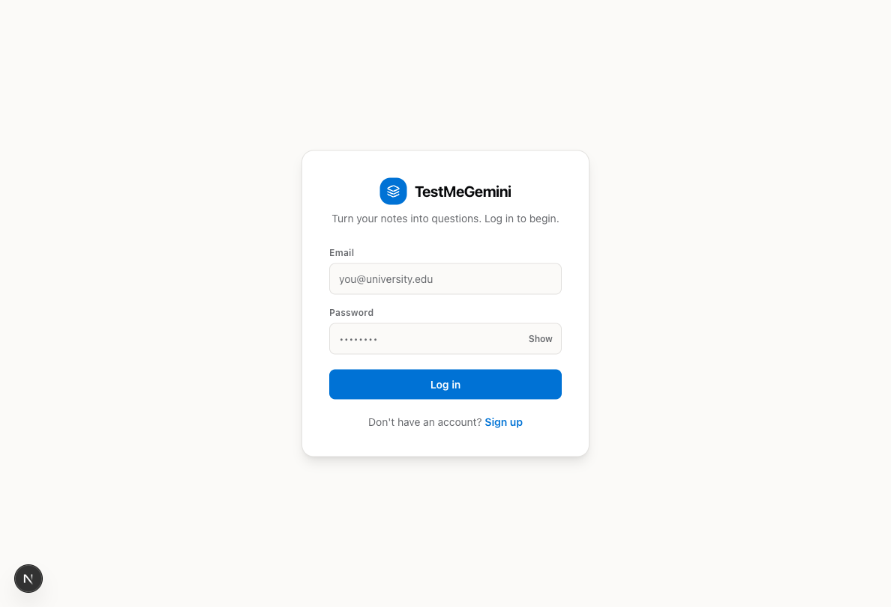
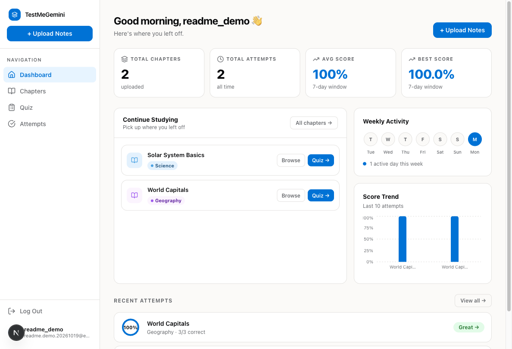
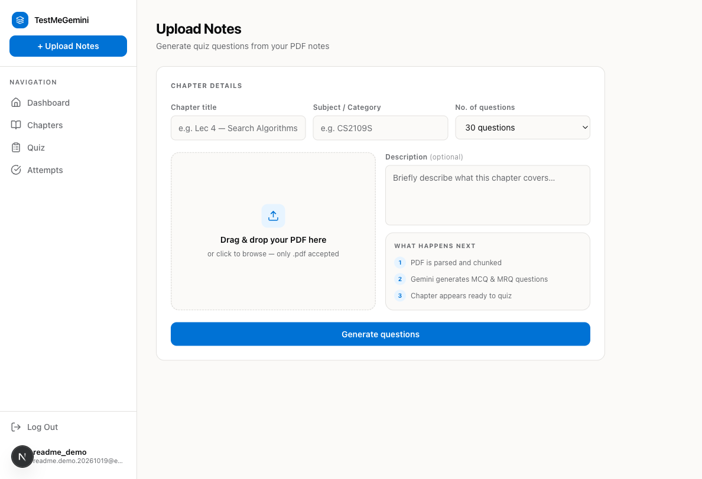
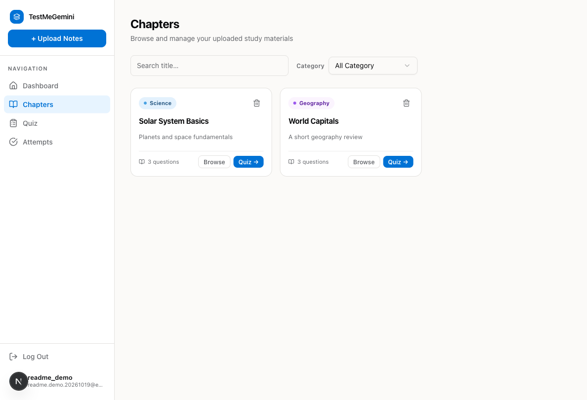
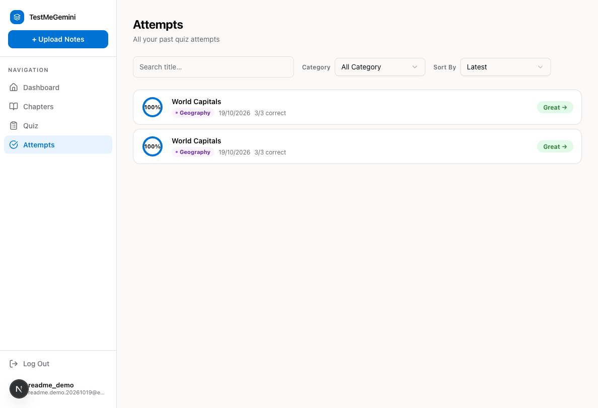
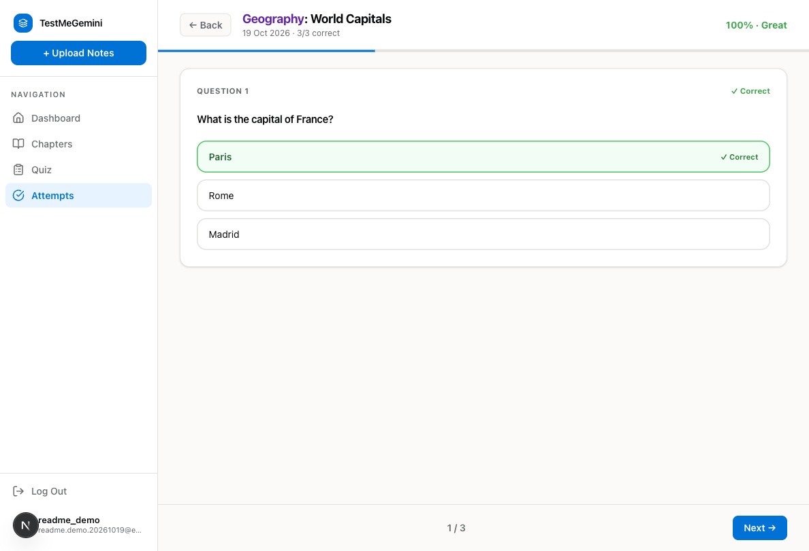
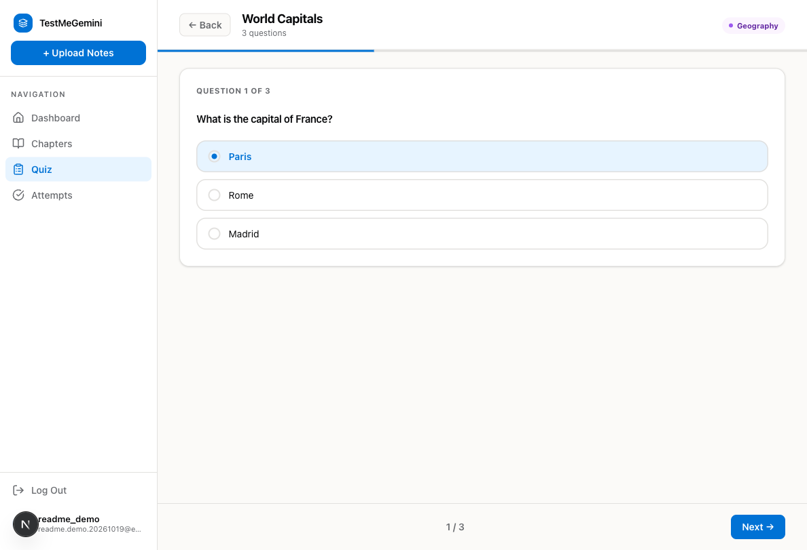
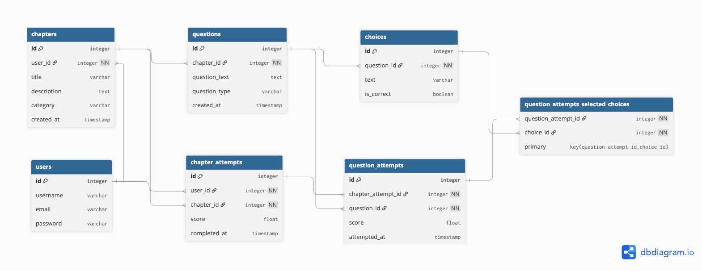

# TestMeGemini

Turn your notes into interactive quizzes and track your learning progress.

## Features

- **User Authentication**  
  Secure authentication with **JWT tokens** and **email login**, ensuring safe access to your account.

- **Upload Notes & Auto-Generate Questions**  
  Upload your study notes in **PDF Format** and automatically generate questions in multiple formats:

  - **MCQ (Multiple Choice Questions)**
  - **MRQ (Multiple Response Questions)**
  - **True/False**

- **Create Chapters and Questions**  
  Organize your content efficiently by creating chapters and questions for quizzes and study material.

- **Take Quizzes & Track Attempts**  
  Test your knowledge with interactive quizzes. Review answers, monitor progress, and analyze performance over multiple attempts.

- **Dashboard with Analytics and Charts**  
  Gain insights into your learning progress through detailed analytics, including charts and performance metrics.

## Upcoming Features

- Support Category creation
- An Analytics page for detailed insights and reporting.
- Asynchronous chapter and question generation powered by Celery for improved performance.
- Notes summary generator

## Screenshots

**Login**



**HomePage / Dashboard**



**Upload PDFs**



**Chapters List**



**Chapter Attempts**



**In Attempt (Question View)**



**In Quiz (Answering)**



## Installation & Local Development

### Quick local start

After installing dependencies and creating `backend/.env`, start Django and
Next.js together from the repository root:

```bash
make local-run
```

The default local URLs are:

- Frontend: `http://127.0.0.1:3000`
- Backend: `http://127.0.0.1:8001`

Port `8001` is used for Django so the app can coexist with tools that commonly
occupy port `8000`. Override either port when needed:

```bash
TESTME_BACKEND_PORT=8100 TESTME_FRONTEND_PORT=3100 make local-run
```

The dashboard, chapters, quizzes, and attempt history work without calling an
AI provider. Uploading a PDF to generate new questions requires a valid
`GEMINI_API_KEY`.

To verify that both servers start, proxy requests correctly, and shut down
cleanly:

```bash
make local-check
```

### Environment Variables

- Backend: copy `backend/.env.example` to `backend/.env`, then set a unique
  `SECRET_KEY` and your `GEMINI_API_KEY`. Production deployments must also set
  `DEBUG=False`, `ALLOWED_HOSTS`, `CORS_ALLOWED_ORIGINS`, and
  `CSRF_TRUSTED_ORIGINS` explicitly.
- Frontend: create `frontend/.env` and set `NEXT_PUBLIC_API_URL` to the backend
  origin.
- SQLite is intended for local development. Configure `DATABASE_ENGINE` and the
  related database variables in `backend/.env.example` for a production SQL
  database.

### Using the Makefile (Recommended)

All common setup and run commands are available via the Makefile at the project root. Run these from the project root directory:

#### For full list of commands

```bash
make help
```

#### 1. Install dependencies (backend & frontend)

```bash
make backend-install
make frontend-install
```

#### 2. Run committed migrations

```bash
make backend-migrate
```

#### 3. Start the development servers (in separate terminals)

```bash
make backend-run
make frontend-run-dev
```

#### 4. Build for production

```bash
make frontend-build
make frontend-run-prod
```

### Tests

```bash
make test-backend
make test-frontend
make test-e2e
make test-all
```

The Playwright command is added by the full QA setup and uses an isolated test
database; it does not call Gemini.

For verified click-by-click behavior, every versioned endpoint, Django/DRF
implementation details, and the latest test record, see [docs/QA.md](docs/QA.md).

## Architecture Overview

- **Architecture:** Single Page Application
- **Backend:** Django REST Framework, cookie-based JWT authentication, CSRF
  protection, and Google Gemini integration for question generation.
- **Frontend:** Next.js (App Router), React, Tailwind CSS, shadcn/ui, Recharts for charts.
- **Database:** SQLite (default, can be swapped for Postgres/MySQL)
- **Database Modelling**: 

## API

New clients should use the versioned `/api/v1/` routes:

- `/api/v1/auth/` for CSRF bootstrap, login, logout, and refresh
- `/api/v1/users/` for registration and the authenticated user profile
- `/api/v1/chapters/` for chapter CRUD and chapter questions
- `/api/v1/chapter-generations/` for throttled PDF-to-question generation
- `/api/v1/attempts/` for attempt submission and history

Browser clients must first request `/api/v1/auth/csrf/` and send the resulting
CSRF token on unsafe cookie-authenticated requests. Older `/api/` routes remain
temporarily available for compatibility.

The default `SameSite=Lax` cookie mode is intended for same-site deployments.
If the frontend and backend are genuinely cross-site, configure `SameSite=None`
and secure HTTPS cookies explicitly.

## AI Model

The application currently uses the Google Gen AI SDK with this Gemini fallback chain:

1. `gemini-3.8-flash` — primary model, selected for its output quality and current stable free-tier availability.
2. `gemini-3.6-flash` — stable general-purpose fallback when the primary model is temporarily overloaded.
3. `gemini-3.5-flash-lite` — final, cost-efficient stable fallback for availability.

All three model IDs are stable Google Gemini API models, accept text/PDF input, support structured output, and are currently eligible for free input/output usage within a project's free-tier quota. Exact RPM, TPM, and daily limits vary by project and are shown in Google AI Studio. Free-tier prompts and uploaded content may be used by Google to improve its products, so do not upload private or sensitive documents without reviewing Google's current data-use terms.

The application extracts text from uploaded PDFs and asks Gemini to return the chapter summary and quiz questions as JSON matching the Pydantic response schema. The selected question count is enforced in the prompt, with JSON Schema `minItems`/`maxItems`, and through server-side validation before anything is saved.

Fallback occurs only for transient overload, service-unavailable, or deadline-timeout failures (HTTP 503/504). Each model is retried twice before the application advances to the next model. Other provider errors stop immediately and return a safe generation error.

Model configuration is defined by `MODEL_CHAIN` in `backend/api/utils/ai.py`. Authentication and timeout configuration use:

```env
GEMINI_API_KEY=your-google-ai-api-key
GEMINI_TIMEOUT_SECONDS=30
```

Google model references: [Gemini 3.8 Flash](https://ai.google.dev/gemini-api/docs/models/gemini-3.8-flash), [Gemini 3.6 Flash](https://ai.google.dev/gemini-api/docs/models/gemini-3.6-flash), [Gemini 3.5 Flash-Lite](https://ai.google.dev/gemini-api/docs/models/gemini-3.5-flash-lite), [pricing](https://ai.google.dev/gemini-api/docs/pricing), and [rate limits](https://ai.google.dev/gemini-api/docs/rate-limits).

### Observability

- The service adds an internal `_model_used` field for downstream logging/analytics.
- Fallback and retry logic lives in `backend/api/utils/ai.py` (`call_gemini_model`). Adjust the order with `MODEL_CHAIN`.

## License

MIT
